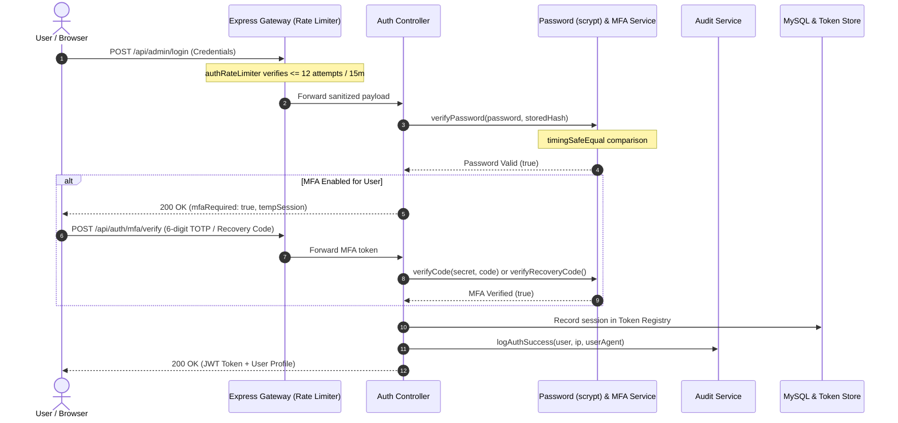

# PUVIMA Consultancy — Authentication & Role-Based Access Control (RBAC)

## 1. Authentication Architecture

PUVIMA Consultancy employs a unified, multi-factor identity architecture serving public visitors, candidate applicants, employees, interns, HR coordinators, and executive administrators.



---

## 2. Password Security & Cryptographic Standards

### 2.1 Cryptographic Hashing Specification
- **Algorithm**: `scrypt` (OWASP ASVS & Password Storage Cheat Sheet compliant).
- **CPU / Memory Cost ($N$)**: 16,384 ($2^{14}$).
- **Block Size ($r$)**: 8.
- **Parallelization Parameter ($p$)**: 1.
- **Key Length**: 64 bytes (512 bits).
- **Salt Generation**: 32 cryptographically random bytes via `crypto.randomBytes(32)` per user.
- **Storage Format**: `scrypt$N=16384,r=8,p=1$<salt_hex>$<derived_key_hex>`.

### 2.2 Constant-Time Verification
All string comparisons are evaluated using `crypto.timingSafeEqual`:
```javascript
function safeEqual(a, b) {
  if (typeof a !== 'string' || typeof b !== 'string') return false;
  const bufA = Buffer.from(a, 'utf8');
  const bufB = Buffer.from(b, 'utf8');
  if (bufA.length !== bufB.length) {
    crypto.timingSafeEqual(bufA, bufA); // Normalize timing
    return false;
  }
  return crypto.timingSafeEqual(bufA, bufB);
}
```

### 2.3 Transparent Legacy Migration
Existing legacy installations using plaintext configurations are verified timing-safely and flagged for automatic hashing upon subsequent modification without locking out administrative users.

### 2.4 Password Strength Policy
Enforced via `validatePasswordStrength()`:
- Minimum length: 10 characters (maximum: 128 characters).
- At least one uppercase letter (`A-Z`).
- At least one lowercase letter (`a-z`).
- At least one numerical digit (`0-9`).
- At least one special character (`!@#$%^&*()_+-=[]{};':"|,.<>/?`).
- Rejection of common breached dictionary passwords (`password`, `admin123`, `puvima123`, etc.).

---

## 3. Multi-Factor Authentication (RFC 6238 TOTP)

### 3.1 Standards & Protocols
- Compatible with Google Authenticator, Microsoft Authenticator, and Authy.
- Time step: 30 seconds.
- Digits: 6 numerical digits.
- Clock drift tolerance: $\pm 1$ step (current step, -30s, +30s) to account for client-server time drift.

### 3.2 Single-Use Recovery Codes
- When enrolling, users receive 8 cryptographically unique recovery keys (`PUV-XXXX-XXXX`).
- Stored on the server strictly as SHA-256 hashes (`crypto.createHash('sha256')`).
- Consumed single-use codes are permanently removed from the array upon verification, preventing replay attacks.

### 3.3 Enrollment & Activation Flow
1. **Enrollment Request**: `POST /api/auth/mfa/enroll` generates an unactivated base32 secret and `otpauth://` URI.
2. **Proof-of-Possession**: `POST /api/auth/mfa/activate` requires submitting the secret alongside a valid 6-digit TOTP code.
3. **Activation**: MFA is marked active only after successful verification.

---

## 4. JWT Hardening & Token Revocation

### 4.1 Header & Signature Hardening
- Header `alg` is strictly validated to ensure it equals `HS256`.
- Payloads are decoded, checked for expiration (`exp`), and verified timing-safely against the secret HMAC.

### 4.2 Token Revocation Registry
- Calling `POST /api/auth/logout` or `POST /api/admin/logout` writes the token's SHA-256 signature hash into the revocation store.
- Any subsequent request carrying a revoked token is rejected with `401 Unauthorized`.
- Expired tokens are purged periodically to prevent memory bloat.

---

## 5. Role-Based Access Control (RBAC) Matrix

PUVIMA platform defines four discrete roles:

| Endpoint Group | SuperAdmin | HR Coordinator | Employee | Intern | Public Visitor |
| :--- | :---: | :---: | :---: | :---: | :---: |
| **Public Website & Careers Form** | Read/Write | Read/Write | Read | Read | Read/Submit |
| **Internship Applications (Review)** | Full Access | Full Access | **403 Forbidden** | **403 Forbidden** | **401 Unauthorized** |
| **Candidate Resumes Download** | Full Access | Full Access | **403 Forbidden** | **403 Forbidden** | **401 Unauthorized** |
| **Status Mutations & Hiring Notes** | Full Access | Full Access | **403 Forbidden** | **403 Forbidden** | **401 Unauthorized** |
| **Administrative Settings & Stats** | Full Access | **403 Forbidden** | **403 Forbidden** | **403 Forbidden** | **401 Unauthorized** |
| **Audit Logs Inspection** | Full Access | **403 Forbidden** | **403 Forbidden** | **403 Forbidden** | **401 Unauthorized** |
| **Corporate Mail Application** | Full Access | Full Access | Read Own | **403 Forbidden** | **401 Unauthorized** |

### 5.1 Defense Against Header Spoofing & IDOR
- Portal headers (`x-portal-user-role`, `x-portal-user-id`) are only evaluated if corroborated by a valid cryptographically signed JWT token.
- Unauthenticated or mismatched role headers trigger an immediate `401 Unauthorized` or `403 Forbidden`.

