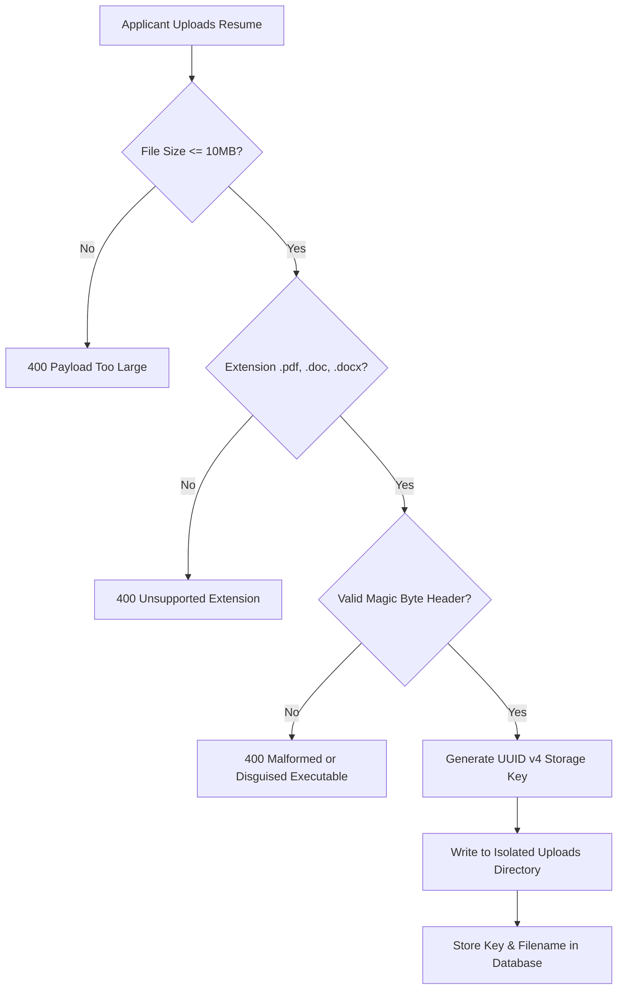

# PUVIMA Consultancy — File Upload Security Architecture

## 1. Scope & Threat Context

Candidate applications submitted through the PUVIMA Careers portal (`/pages/careers`) require applicants to upload authentic resume documents (PDF, DOC, DOCX).

File upload mechanisms represent a primary vector for remote code execution (RCE), arbitrary file overwrite, server-side cross-site scripting (Stored XSS), and directory traversal attacks if not guarded by defense-in-depth controls.



---

## 2. Ingestion Validation Pipeline

### 2.1 File Size Enforcement
All incoming uploads are checked by Multer and body parsers before streaming to disk:
- Maximum file size: **10 Megabytes (10,485,760 bytes)**.
- Oversized uploads trigger an immediate `400 Bad Request` and terminate the TCP stream without buffering.

### 2.2 Extension Whitelisting
Filename extensions are extracted and validated against an explicit allowlist:
- Permitted extensions: `.pdf`, `.doc`, `.docx`.
- All other extensions (including `.exe`, `.bat`, `.sh`, `.php`, `.js`, `.svg`, `.html`, `.phtml`, `.jsp`) are unconditionally rejected.

### 2.3 Binary Magic Byte Verification
Extension validation alone is insufficient, as malicious actors frequently rename dangerous executable binaries to `.pdf`. 

The upload pipeline inspects the initial binary buffer (magic bytes) using cryptographic buffer comparisons:
- **PDF Documents**: Must begin with `%PDF-` (`0x25 0x50 0x44 0x46 0x2D`).
- **Legacy Microsoft Word (DOC)**: Must begin with OLE compound document signature (`0xD0 0xCF 0x11 0xE0 0xA1 0xB1 0x1A 0xE1`).
- **Office OpenXML (DOCX)**: Must begin with PK Zip container signature (`0x50 0x4B 0x03 0x04`).

Any file failing magic byte inspection is immediately deleted and rejected with `400 Bad Request`.

---

## 3. Storage Security & Path Traversal Prevention

### 3.1 Unpredictable Storage Key Generation
Original applicant filenames (which may contain spaces, non-ASCII characters, or path traversal sequences) are **never** used as disk storage keys.
- **Generated Key**: `uuid_v4.ext` (e.g., `f47ac10b-58cc-4372-a567-0e02b2c3d479.pdf`).
- Original filenames are sanitized and stored separately in MySQL purely as metadata for display purposes.

### 3.2 Path Traversal Defenses
File resolution uses strict path boundaries:
```javascript
const safeFilename = path.basename(requestedFile);
const fullPath = path.resolve(STORAGE_DIR, safeFilename);

if (!fullPath.startsWith(STORAGE_DIR)) {
  throw new Error('Directory traversal attempt detected');
}
```

### 3.3 Isolation from Web Root
The storage directory (`uploads/resumes/` or serverless `/tmp/puvima-resumes`) is maintained outside the web root (`public/` or `frontend/`). Files cannot be requested directly by URL; they can only be streamed through authenticated API routes.

---

## 4. Secure Resume Delivery & Download Protection

When an authorized HR coordinator or SuperAdmin requests a candidate's resume (`/api/hr/internship-applications/:id/resume`):

1. **Authentication Check**: Request must carry a verified HR or Admin JWT token.
2. **Audit Event Logged**: `auditService.logResumeAccess()` records the accessor, timestamp, application ID, and IP address.
3. **Response Headers**:
   - `Content-Type`: Set strictly to `application/pdf` or application MIME type.
   - `Content-Disposition`: Set to `inline; filename="<sanitized_name>"`.
   - `X-Content-Type-Options: nosniff`: Prevents browser MIME-type sniffing from executing SVG or HTML payloads disguised as PDFs.

---

## 5. Version Control & Repository Isolation

Candidate resumes and personal identifying documents must never be committed to git repositories.

The project root `.gitignore` explicitly excludes all upload paths:
```gitignore
# Sensitive uploads and documents
uploads/
backend/uploads/
uploads/resumes/
backend/uploads/resumes/
!uploads/.gitkeep
!backend/uploads/.gitkeep
!backend/uploads/resumes/.gitkeep
```

