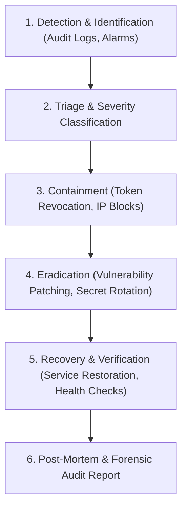

# Puvima IT Service and Research Consultancy — Security Incident Response Plan (IRP)

## 1. Overview & Objectives

This Incident Response Plan defines operational procedures to detect, contain, investigate, and remediate cybersecurity incidents impacting Puvima IT Service and Research Consultancy (`puvima.com`). 

Objectives:
- Protect candidate PII, client consultations, corporate emails, and platform infrastructure.
- Minimize service disruption and operational downtime.
- Preserve forensic evidence for analysis and legal compliance.
- Satisfy statutory breach notification requirements under applicable data protection regulations.

---

## 2. Incident Classification & Severity Levels

| Severity Level | Definition | Example Incident | Response Target |
| :---: | :--- | :--- | :---: |
| **P1 - Critical** | Catastrophic incident; total service loss, active database compromise, administrator account takeover, or large-scale data breach. | Unauthenticated exfiltration of candidate resumes; remote code execution on backend server. | **Immediate (< 15 mins)** |
| **P2 - High** | Significant incident; targeted attack against authentication, single staff credential compromise, or high-volume DoS. | Brute force breach of an HR coordinator account; failure of rate limiting layer under flood. | **< 1 hour** |
| **P3 - Medium** | Moderate security event without confirmed data compromise. | Elevated rate limiter triggers; individual suspicious resume upload blocked by magic byte check. | **< 4 hours** |
| **P4 - Low** | Minor anomaly, security scanner probe, or false positive. | Automated web vulnerability scan on public routes; sporadic invalid login attempts. | **< 24 hours** |

---

## 3. Incident Response Lifecycle

### Phase 1: Detection & Identification
- Real-time alerts generated by `audit.service.js` for `AUTH_FAILURE`, `AUTHORIZATION_DENIED`, and `RATE_LIMIT_EXCEEDED`.
- Server infrastructure monitoring (CPU spikes, memory exhaustion, network throughput anomalies).
- User or candidate reports of anomalous platform behavior.

### Phase 2: Containment Playbooks

#### Playbook A: Compromised Administrator Account
1. **Revoke Active Tokens**:
   Execute instant token revocation via `POST /api/auth/logout` or manually append the user's active session token to the token revocation list.
2. **Rotate Password**:
   Reset the user's password to a high-entropy string using `hashPassword()`.
3. **Reset MFA Credentials**:
   Purge existing MFA enrollment from `mfa_credentials` table and local JSON store, forcing fresh enrollment with new recovery keys.
4. **Audit Review**:
   Query `GET /api/admin/audit-logs?search=<user_email>` to inspect all actions executed during the compromised window.

#### Playbook B: Suspicious IP Address / Brute Force Surge
1. Identify the attacking IP address from `RATE_LIMIT_EXCEEDED` audit logs.
2. Add the offending IP or CIDR block to edge firewall or reverse proxy blocklist.
3. Verify that `authRateLimiter` is successfully returning `429 Too Many Requests`.

#### Playbook C: Suspected Data Exfiltration Attempt
1. Immediately restrict network egress by verifying outbound hosts via `ssrfGuard.js`.
2. Inspect `security_audit_logs` for `RESUME_ACCESSED` records to determine affected application IDs.
3. If necessary, place the affected service in read-only maintenance mode.

### Phase 3: Eradication
- Identify the root cause (e.g., outdated dependency, leaked credential, weak password).
- Apply relevant code patches and rebuild deployment containers.
- Rotate all platform secrets (`JWT_SECRET`, database passwords, Supabase keys, GoDaddy mail credentials).

### Phase 4: Recovery
- Re-run complete test suite (`npm test --prefix backend`) to verify 100% test pass rate.
- Deploy patched release to production via verified CI/CD pipeline.
- Monitor audit logs closely for 48 hours for repeated attack attempts.

### Phase 5: Post-Incident Review & Lessons Learned
- Conduct blameless post-mortem within 5 business days.
- Document timeline, root cause, impact, containment efficacy, and permanent prevention tasks.
- If PII was compromised, coordinate statutory breach notifications within mandatory regulatory windows (e.g., 72 hours).

