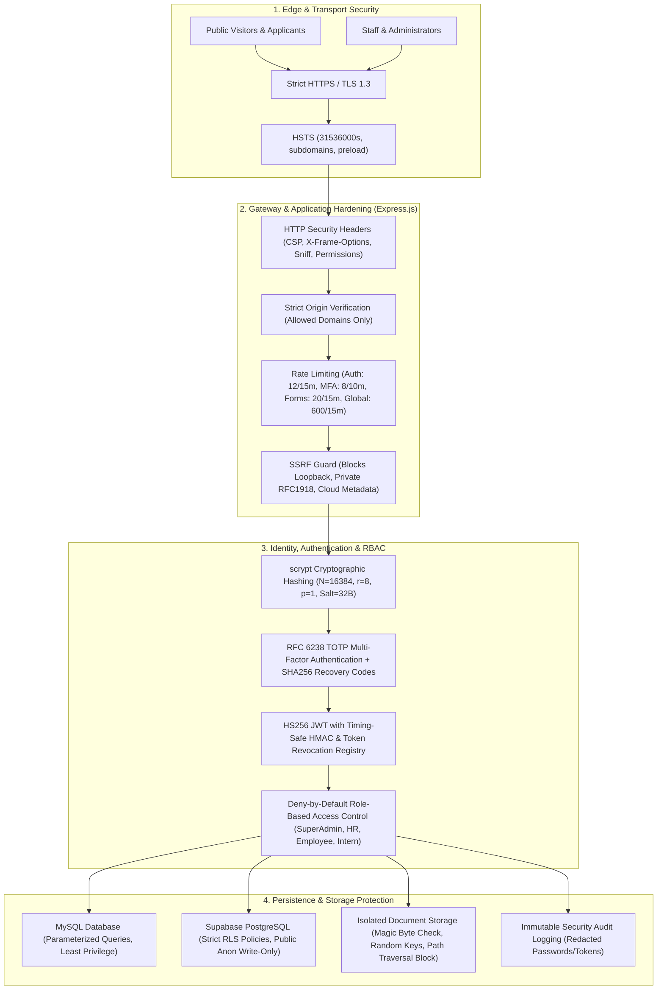

# Puvima IT Service and Research Consultancy — Enterprise Security Architecture

## 1. Executive Summary & Architecture Overview

Puvima IT Service and Research Consultancy (`puvima.com`) operates a multi-tier enterprise web platform delivering consultancy services, research prototyping, IT solutions, dedicated executive mail, and candidate recruitment workflows. 

This security architecture establishes a comprehensive, zero-trust defense-in-depth model protecting corporate assets, client consultations, applicant dossiers, administrator credentials, and server infrastructure.

---

## 2. Multi-Layer Defense in Depth

### Layer 1: Edge & Network Security
- **Strict HTTPS Enforcement**: Enforces TLS 1.3 with automated HTTP-to-HTTPS redirect (`301 Moved Permanently`) in production.
- **HSTS Hardening**: 1-year `max-age=31536000` with `includeSubDomains` and `preload` directives.
- **Server-Side Request Forgery (SSRF) Guard**: All outbound network connectors (e.g., IMAP/SMTP mail configuration) are intercepted by `ssrfGuard.js`. Resolves target hostnames prior to socket establishment and strictly prohibits loopback (`127.0.0.0/8`, `::1`), private subnets (`10.0.0.0/8`, `172.16.0.0/12`, `192.168.0.0/16`), link-local (`169.254.0.0/16`), and cloud metadata APIs (`169.254.169.254`, `metadata.google.internal`).

### Layer 2: HTTP Header & Gateway Hardening
- **Content Security Policy (CSP)**: Restricts script, style, font, and frame loading to authenticated, approved origins. Disallows arbitrary frame embedding (`frame-ancestors 'none'`).
- **Clickjacking Protection**: `X-Frame-Options: DENY` ensures no PUVIMA portal or admin UI can be rendered within malicious iframes.
- **MIME Sniffing Block**: `X-Content-Type-Options: nosniff` forces browsers to respect explicit server MIME declarations.
- **Feature & Permissions Policy**: `Permissions-Policy: camera=(), microphone=(), geolocation=(), payment=()` disables invasive browser APIs across all contexts.
- **Cross-Origin Resource Sharing (CORS)**: Strict origin validation allowing only registered production domains, Vercel deployments, and controlled local loopback during development.

### Layer 3: Identity & Authentication Protection
- **Cryptographic Password Storage**: Utilizes OWASP-recommended `scrypt` algorithm ($N=16384, r=8, p=1$) with a 32-byte cryptographically secure random salt (`crypto.randomBytes`).
- **Timing-Attack Resistance**: All credential, signature, and token comparisons execute using `crypto.timingSafeEqual` over fixed-length buffers, defeating side-channel timing analysis.
- **Multi-Factor Authentication (MFA)**: Full RFC 6238 Time-Based One-Time Password (TOTP) support with 30-second intervals and a $\pm 1$ step clock skew tolerance. Includes 8 single-use cryptographically generated recovery codes stored as SHA-256 hashes.
- **Token Lifecycle & Revocation**: JWT sessions include strict expiration, signature verification (`alg: HS256` validation), and an active revocation registry preventing token replay after logout.
- **Brute-Force & Credential Stuffing Prevention**: Distinct sliding-window rate limiters across sensitive routes:
  - Authentication endpoints: 12 attempts per 15 minutes.
  - MFA verification: 8 attempts per 10 minutes.
  - Public submission forms: 20 requests per 15 minutes.
  - Global API limiter: 600 requests per 15 minutes.

### Layer 4: Centralized Authorization & RBAC
- **Strict Role Separation**: Hierarchical role authorization (`SuperAdmin` $\supset$ `HR` $\supset$ `Employee` / `Intern`).
- **IDOR and Elevation Prevention**: Management endpoints strictly reject Employee and Intern roles with `403 Forbidden`. Portal session headers are validated against authenticated JWT tokens.
- **Deny-by-Default Architecture**: Any unauthenticated request to non-public endpoints triggers an immediate `401 Unauthorized`.

### Layer 5: Data Persistence & Storage Protection
- **Parameterized SQL**: All MySQL interactions utilize parameterized queries via `mysql2/promise`, completely neutralizing SQL Injection (SQLi).
- **Supabase Row Level Security (RLS)**: Anonymous visitors are restricted to `INSERT` operations only on public contact and booking tables. Public `SELECT`, `UPDATE`, and `DELETE` queries are prohibited, with full administrative access restricted to backend service roles.
- **Secure File Ingestion**: Uploaded candidate resumes undergo multi-factor file inspection:
  - Magic byte binary header validation (PDF `%PDF-`, DOC `\xD0\xCF\x11\xE0`, DOCX `PK\x03\x04`).
  - Storage key obfuscation via UUID v4, preventing predictable file guessing.
  - Path traversal checks defeating `../` directory escapes.
  - Exclusion of upload and credential folders from git repositories.
- **Immutable Security Audit Logging**: Every critical security action (logins, logouts, failures, admin actions, resume reads) is permanently recorded with automatic redaction of sensitive credentials.

